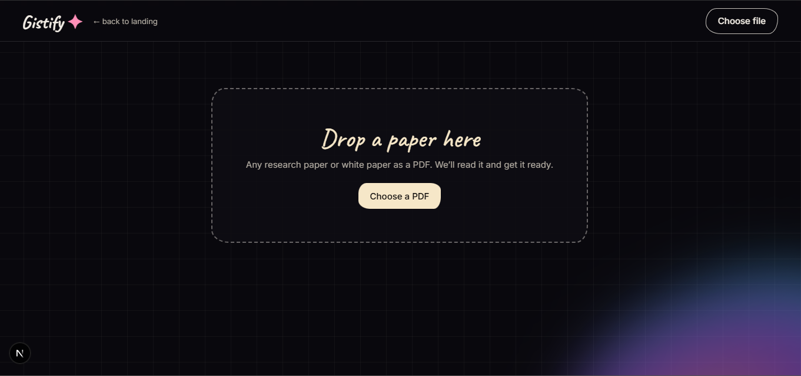
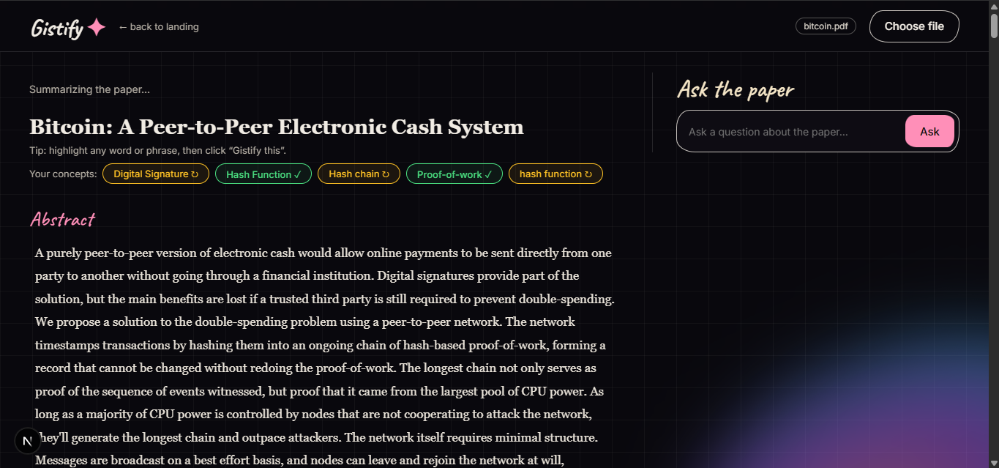
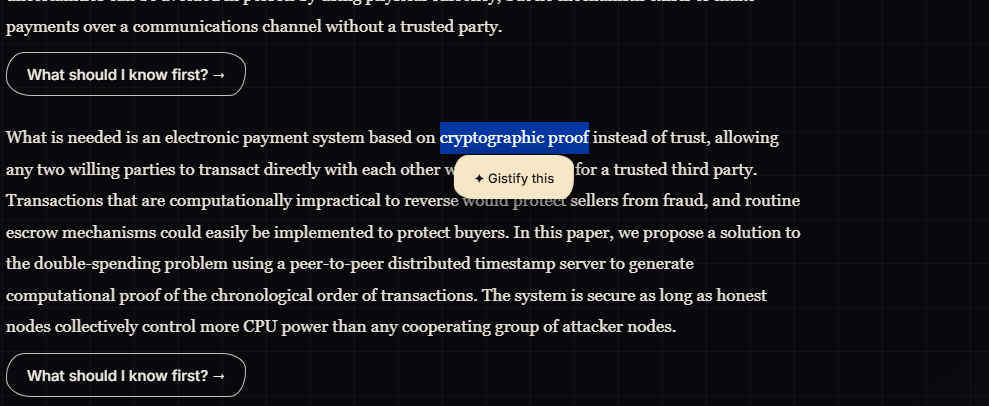
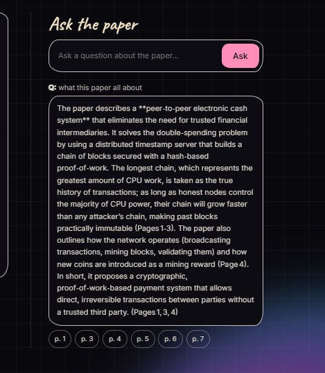
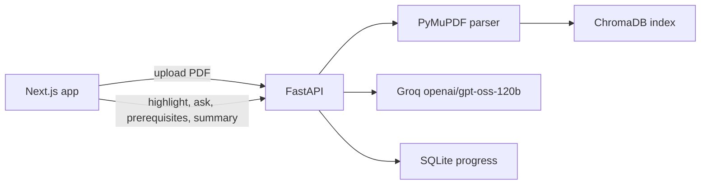

# Gistify

**Stop googling mid-paper. Highlight. Understand. Keep reading.**

Gistify is an AI reading companion for hard technical papers. Upload a PDF, highlight any word or phrase you don't understand, and get a plain-English explanation drawn from the paragraph you're reading. Ask questions about the paper and get answers with page citations that jump you straight to the source.

> **Demo video:** https://github.com/user-attachments/assets/8b1c1b37-3875-4a16-ad2f-721551307881

## The problem

Research papers assume you already know many prerequisite concepts. When you hit an unfamiliar term, you leave the PDF to search Google, YouTube, or a chatbot. That breaks your reading flow and gives scattered explanations that aren't tied to the paper you're reading.

## Features

- **Highlight to explain:** select any word or phrase, click "Gistify this", and get an explanation that uses the surrounding paragraph as context. Several explanations can stack under the same paragraph.
- **Ask the paper:** chat with the paper using retrieval-augmented generation (RAG). Answers come only from the paper's text, citations show one chip per page, and clicking a chip scrolls to and highlights the source paragraph. If the paper doesn't cover the question, it says so instead of guessing.
- **Prerequisite detection:** for any paragraph, get the 3 to 5 concepts you should know first, each explained simply, returned as structured JSON.
- **Progress tracking:** mark each concept "understood" or "needs revision". Progress is saved per paper in SQLite and reloaded when you upload the same paper again.
- **Auto-summary:** a structured summary (problem, key idea, results, why it matters) appears after upload.
- **Clean reading view:** the parser removes author lists, emails, running headers, page numbers, and the reference list, adds the paper title and section headings, and shows figures and tables as inline images instead of garbled text.

## Screenshots

| Landing | Reader |
|---|---|
|  |  |

| Highlight to explain | Ask the paper |
|---|---|
|  |  |

_Add these four images to `docs/screenshots/`._

## How it works



1. **Parsing:** PyMuPDF reads each page as layout blocks in reading order. Small blocks are merged into paragraphs of about 400 characters, each with an id, a page number, and a section. Figures and tables are detected, rendered as images, and kept in reading order.
2. **Indexing:** paragraphs are embedded with ChromaDB's built-in local embedding model and stored with their page numbers.
3. **Explaining a term:** the highlighted text and its paragraph are sent to the LLM, so the explanation reflects how this paper uses the term.
4. **Asking a question:** the question retrieves the most relevant paragraphs (plus the opening ones, so broad questions have context). The LLM answers using only those, and the sources come back with the answer.
5. **Prerequisites:** the LLM runs in JSON mode and returns concepts as `{term, explanation}` objects, which the backend validates before sending them on.

## Tech stack

| Part | Technology |
|---|---|
| Frontend | Next.js, TypeScript |
| Backend | Python, FastAPI |
| PDF parsing | PyMuPDF |
| Retrieval | ChromaDB with local embeddings |
| LLM | openai/gpt-oss-120b on Groq |
| Storage | SQLite (learning progress) |

## Project structure

```
backend/
  main.py            # app setup, CORS, routers
  config.py          # settings and model name
  schemas.py         # request models
  routers/           # API endpoints only
  services/          # parsing, RAG, LLM, prerequisites, summary
  db/                # SQLite progress storage
frontend/
  app/page.tsx       # landing page (/)
  app/app/page.tsx   # reader (/app)
  app/globals.css    # styles
  app/layout.tsx
```

Routers handle HTTP only. All the logic lives in `services/`, and `services/llm.py` wraps the LLM in a single `generate()` function, so switching providers means editing one file.

## Run it locally

You need Python 3.10+, Node.js 20+, and a free [Groq API key](https://console.groq.com).

**Backend**

```bash
cd backend
python -m venv venv
venv\Scripts\activate          # macOS/Linux: source venv/bin/activate
pip install -r requirements.txt
```

Create `backend/.env` from `.env.example` and add your key:

```
GROQ_API_KEY=your_key_here
```

```bash
uvicorn main:app --reload
```

The API runs at http://localhost:8000, with interactive docs at http://localhost:8000/docs.

**Frontend**

```bash
cd frontend
npm install
npm run dev
```

Open http://localhost:3000, click "Try it", and drop in a PDF. The first upload is slower because ChromaDB downloads its embedding model once.

To point the frontend at a different API address, set `NEXT_PUBLIC_API_URL`.

## API

| Endpoint | Purpose |
|---|---|
| `POST /upload` | parse a PDF into ordered text and figure items, and index the text |
| `POST /explain` | explain a highlighted term using its paragraph |
| `POST /ask` | answer a question from the paper, with sources |
| `POST /prerequisites` | list prerequisite concepts for a paragraph |
| `POST /summarize` | summarize the uploaded paper |
| `POST /progress`, `GET /progress` | save and load concept progress |
| `GET /health` | health check |

## Design decisions and limitations

- **RAG instead of sending the whole paper:** retrieval keeps answers grounded, keeps prompts small, and makes page citations possible.
- **Prompt-based "not covered" fallback:** the model is told to answer only from the retrieved text. I tuned this by testing broad, specific, and off-topic questions, because a prompt that is too strict refuses valid questions and one that is too loose invents details.
- **The index lives in memory:** restarting the server means re-uploading the paper, and only one paper is loaded at a time. Progress is stored in SQLite and survives restarts.
- **The summary reads the opening of the paper** (about 10,000 characters) to stay within rate limits, so results from later sections can be missing.
- **Parsing uses heuristics:** it expects an "Abstract" heading and a "References" heading. Papers without them keep some front matter or back matter, and two-column layouts can interleave.
- **Scanned PDFs are not supported** (no OCR).
- **Citations show the passages retrieved,** not proof of which ones the model actually relied on.
- **Concept progress is matched by exact concept name,** so a differently worded concept counts as a new one.
- **Groq's free tier is rate limited,** so rapid requests can return a temporary error. Wait a minute and retry.

## Roadmap

- [x] PDF upload with clean, sectioned parsing and inline figures
- [x] Highlight to explain
- [x] RAG chat with page citations and a "not covered" fallback
- [x] Prerequisite detection with saved progress
- [x] Auto-summary
- [ ] Flowcharts for key processes
- [ ] Quizzes after each concept
- [ ] A concept graph and difficulty levels
- [ ] Progress carried across papers
- [ ] A persistent index and multiple papers
- [ ] OCR for scanned PDFs
